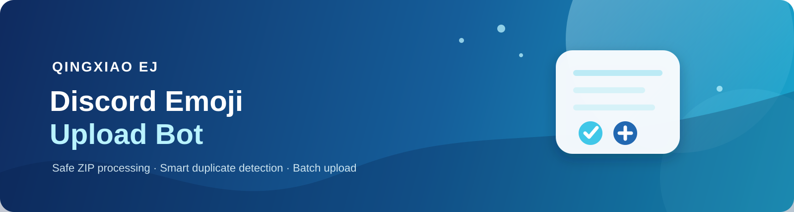

<p align="center">
  
</p>

<p align="center">
  <a href="https://www.python.org/downloads/"></a>
  <a href="https://discordpy.readthedocs.io/"></a>
  <a href="https://python-pillow.org/"></a>
  <a href="https://github.com/yt-dlp/yt-dlp"></a>
  <a href="https://docs.aiohttp.org/"></a>
  
</p>

<h1 align="center">BOT Qingxiao (Qingxiao EJ)</h1>

<p align="center">
  <b>Bot Discord đa chức năng: Upload Emoji hàng loạt từ ZIP & Phân tích chuyên sâu link TikTok / OAuth Login Kit</b>
</p>

<p align="center">
  
  
  
  
</p>

> [!NOTE]
> **Xác minh trạng thái mã nguồn (`bot.py`):**
> File chính `bot.py` hiện có **1.847 dòng** code thực tế (giao diện GitHub cơ sở hiển thị khoảng 1.401 dòng trước khi hoàn thiện module tích hợp OAuth server và video stream probe). Toàn bộ dự án được thiết kế theo kiến trúc phi đồng bộ (`asyncio`), tuân thủ nghiêm ngặt Discord API chính thức và bảo mật tài nguyên.

---

## 📌 Phân định Tri thức (Knowledge Base Separation)

Để tránh nhầm lẫn giữa hai miền tính năng hoàn toàn độc lập trong cùng một codebase, tài liệu này phân tách rõ ràng thành **2 Mục Tri Thức**:

| Tiêu chí | Mục Tri Thức 1: Bulk Emoji Uploader | Mục Tri Thức 2: TikTok Analytics & OAuth |
|---|---|---|
| **Mục đích** | Upload hàng loạt custom emoji từ file ZIP lên Guild Discord | Phân tích siêu dữ liệu video TikTok & Tích hợp TikTok Login Kit |
| **Cơ chế kích hoạt** | Slash command: `/upload-emojis`, `/ping` | Sự kiện `on_message` (regex URL) & Slash commands: `/connect-tiktok`, `/tiktok-account`, `/disconnect-tiktok` |
| **Quyền Discord bắt buộc** | `manage_emojis_and_stickers` (cả User gọi lệnh và Bot) | `View Channels`, `Send Messages`, `Embed Links`, `Read Message History` *(Tùy chọn: `Manage Messages` để ẩn preview link gốc)* |
| **Thư viện nòng cốt** | `Pillow`, `zipfile`, `hashlib`, `tempfile`, `shutil` | `aiohttp`, `yt-dlp`, `subprocess` (ffprobe tùy chọn), `urllib`, `secrets` |
| **Phụ thuộc ngoại vi** | Không phụ thuộc | **Tùy chọn:** FFmpeg / `ffprobe` *(tự động fallback nếu thiếu, không gây lỗi)* |
| **Đường đi I/O & Mạng** | Tải ZIP -> Discord CDN (hash emoji cũ) -> Gửi payload emoji lên Discord API | Gọi TikWM API -> Trích xuất stream metadata -> Gọi TikTok OAuth API |
| **Quản lý dữ liệu tạm** | Thư mục tạm đĩa cứng (`tempfile`), dọn dẹp tuyệt đối trong `finally` | Bộ nhớ tiến trình RAM (`TIKTOK_TOKENS`, `TIKTOK_OAUTH_STATES`) |

---

## Mục lục

1. [Mục Tri Thức 1: Bulk Emoji Uploader](#-mục-tri-thức-1-bulk-emoji-uploader)
   - [Mục đích và phạm vi](#11-mục-đích-và-phạm-vi)
   - [Các Handler và Kiểm tra quyền hạn](#12-các-handler-và-kiểm-tra-quyền-hạn)
   - [Đường đi dữ liệu (Data Pipeline)](#13-đường-đi-dữ-liệu-data-pipeline)
   - [Giới hạn kỹ thuật thực tế](#14-giới-hạn-kỹ-thuật-thực-tế)
   - [Thuật toán Fingerprint & Đặt tên](#15-thuật-toán-fingerprint--đặt-tên)
   - [Xử lý ảnh tĩnh & GIF động](#16-xử-lý-ảnh-tĩnh--gif-động)
   - [Xử lý ngoại lệ & Giới hạn Discord](#17-xử-lý-ngoại-lệ--giới-hạn-discord)
   - [Emoji trạng thái động](#18-emoji-trạng-thái-động)
2. [Mục Tri Thức 2: TikTok Analytics & OAuth Integration](#-mục-tri-thức-2-tiktok-analytics--oauth-integration)
   - [Mục đích và phạm vi](#21-mục-đích-và-phạm-vi)
   - [Các Handler, Trigger và Endpoint Web](#22-các-handler-trigger-và-endpoint-web)
   - [Đường đi dữ liệu & Kiến trúc kết hợp đa nguồn](#23-đường-đi-dữ-liệu--kiến-trúc-kết-hợp-đa-nguồn)
   - [Xác minh hoạt động khi thiếu FFmpeg/ffprobe](#24-xác-minh-hoạt-động-khi-thiếu-ffmpegffprobe)
   - [Xử lý ngoại lệ & Độ bền Discord Message](#25-xử-lý-ngoại-lệ--độ-bền-discord-message)
   - [Hệ thống TikTok OAuth Login Kit](#26-hệ-thống-tiktok-oauth-login-kit)
3. [Hướng dẫn cài đặt & Triển khai](#-hướng-dẫn-cài-đặt--triển-khai)
   - [Cài đặt trên Windows](#cài-đặt-trên-windows)
   - [Cài đặt tùy chọn FFmpeg / ffprobe](#cài-đặt-tùy-chọn-ffmpeg--ffprobe)
   - [Triển khai trên Render Web Service](#triển-khai-trên-render-web-service)
4. [Cấu hình biến môi trường (`.env`)](#-cấu-hình-biến-môi-trường-env)
5. [Cấu trúc dự án](#-cấu-trúc-dự-án)
6. [FAQ & Xử lý sự cố](#-faq--xử-lý-sự-cố)

---

## 🎨 Mục Tri Thức 1: Bulk Emoji Uploader

### 1.1 Mục đích và phạm vi
Giúp người quản trị Discord server tải hàng loạt custom emoji từ một file `.zip` lên Guild chỉ với một câu lệnh slash command, tự động chuẩn hóa kích thước, nén dung lượng, lọc ảnh trùng và thông báo chi tiết mà không làm gián đoạn cả batch khi có file lỗi.

### 1.2 Các Handler và Kiểm tra quyền hạn
- **Lệnh chính:** `/upload-emojis (file: Attachment, prefix: str = "emoji")`
- **Lệnh kiểm tra:** `/ping` (trả về độ trễ latency tính bằng ms).
- **Ràng buộc phạm vi:**
  - `@app_commands.guild_only()`: Bắt buộc gọi trong Discord Server (Guild), từ chối thực thi trong tin nhắn riêng Direct Message (DM).
  - `@app_commands.checks.has_permissions(manage_emojis_and_stickers=True)`: Kiểm tra người dùng có quyền quản lý emoji/stickers.
  - Kiểm tra quyền Bot: Kiểm tra `guild.me.guild_permissions.manage_emojis_and_stickers` hoặc `administrator`. Nếu thiếu, trả thông báo lỗi ngay lập tức.
- **Bắt lỗi tương tác:** Handler `@upload_emojis.error` bắt `app_commands.NoPrivateMessage` và `app_commands.MissingPermissions` để phản hồi lịch sự, dễ hiểu.

### 1.3 Đường đi dữ liệu (Data Pipeline)
Luồng dữ liệu của tác vụ upload emoji được thực thi tuần tự theo 8 bước an toàn:

```text
[1] Người dùng gửi /upload-emojis đính kèm emoji.zip
      │
[2] Kiểm tra định dạng (.zip) & dung lượng file tải lên <= 50 MB
      │
[3] Chuẩn hóa prefix (regex a-z0-9_, kiểm tra độ dài <= 28 ký tự)
      │
[4] Defer interaction (thinking...) & Khởi tạo thư mục tạm: temp/emoji_upload_xxxx
      │
[5] Lưu ZIP xuống đĩa -> extract_zip_safely:
      ├─ Chặn Path Traversal (chặn .., null byte, absolute path, windows drive)
      ├─ Kiểm tra số entry <= 500
      ├─ Kiểm tra uncompressed size <= 200 MB (chống ZIP bomb)
      └─ Lọc các file ảnh hợp lệ (.png, .jpg, .jpeg, .gif, .webp) <= 100 files
      │
[6] collect_existing_emoji_fingerprints:
      └─ Tải đồng thời tối đa 8 kết nối CDN, băm SHA-256 các emoji hiện có trên Server
      │
[7] Vòng lặp xử lý từng file ảnh:
      ├─ Chuẩn bị bytes: optimize_static_image hoặc optimize_animated_image
      ├─ Tính fingerprint_image (SHA-256 pixel buffer thumbnail 128x128 RGBA)
      ├─ Kiểm tra trùng 2 lớp: trùng Guild HOẶC trùng trong batch ZIP -> ghi vào skipped
      ├─ Tự sinh tên không trùng: get_next_available_emoji_name (prefix_1, prefix_2,...)
      ├─ Upload: guild.create_custom_emoji(...)
      └─ Chờ 0.1 giây (UPLOAD_DELAY_SECONDS) để tránh rate limit Discord
      │
[8] Tạo Embed báo cáo tổng kết (Thành công / Trùng / Lỗi) & dọn dẹp thư mục tạm (finally)
```

### 1.4 Giới hạn kỹ thuật thực tế
Đối chiếu trực tiếp với các hằng số được định nghĩa trong `bot.py`:

| Thông số kỹ thuật trong code | Giá trị thực tế | Mục đích kỹ thuật |
|---|---:|---|
| `MAX_ZIP_SIZE` | **50 MB** (`50 * 1024 * 1024` bytes) | Giới hạn dung lượng file ZIP tải lên từ Discord |
| `MAX_UNCOMPRESSED_ZIP_SIZE` | **200 MB** (`200 * 1024 * 1024` bytes) | Ngăn chặn tấn công giải nén cạn kiệt bộ nhớ (ZIP bomb) |
| `MAX_ZIP_ENTRIES` | **500 entries** | Giới hạn tổng số file/thư mục duyệt qua trong ZIP |
| `MAX_FILES_PER_UPLOAD` | **100 files** | Giới hạn số file ảnh tối đa được phép upload trong một lượt |
| `MAX_EMOJI_BYTES` | **256 KB** (`256 * 1024` bytes) | Giới hạn dung lượng tối đa cho mỗi emoji theo chuẩn Discord API |
| `MAX_CONCURRENT_CDN_DOWNLOADS` | **8 tác vụ** | `asyncio.Semaphore` kiểm soát lưu lượng tải fingerprint từ CDN |
| `UPLOAD_DELAY_SECONDS` | **0.1 giây** | Khoảng nghỉ giữa các lượt tạo custom emoji để tránh nghẽn rate limit |
| `MAX_EMOJI_NAME_LENGTH` | **32 ký tự** | Độ dài tối đa tên emoji trên Discord (Prefix tối đa: **28 ký tự**) |
| Thang kích thước resize | `128, 112, 96, 80, 64, 48, 32` px | Các mốc kích thước thử nghiệm khi nén ảnh tĩnh và GIF động |
| Định dạng ảnh hỗ trợ | `.png`, `.jpg`, `.jpeg`, `.gif`, `.webp` | Các đuôi file được bộ trích xuất chấp nhận |

### 1.5 Thuật toán Fingerprint & Đặt tên
- **Thuật toán băm nội dung (`fingerprint_image`):**
  - Mở ảnh bằng Pillow, lấy toàn bộ frame (hỗ trợ cả ảnh tĩnh lẫn ảnh động nhiều frame).
  - Với từng frame: chuyển hệ màu về `RGBA`, thu nhỏ tỷ lệ với thuật toán chất lượng cao `Image.Resampling.LANCZOS` về tối đa `128x128`.
  - Băm dữ liệu pixel raw bytes kèm theo chiều rộng (width) và chiều cao (height) bằng thuật toán `SHA-256`.
  - Cho phép phát hiện 2 file hoàn toàn trùng nhau về mặt hình ảnh dù khác tên file hoặc khác định dạng nén (ví dụ `icon.png` và `icon_copy.jpg`).
- **Quy tắc sinh tên emoji (`generate_emoji_name` & `get_next_available_emoji_name`):**
  - Prefix được chuẩn hóa: viết thường, đổi khoảng trắng và ký tự lạ thành `_`, gộp dấu `_` liên tiếp.
  - Tên tạo ra: `<prefix>_<stt>`, ví dụ `pepe_1`, `pepe_2`.
  - Nếu tên đã tồn tại trên Guild hoặc đã được đặt trước bởi ảnh trước trong cùng batch, bot tự động tăng STT lên số tiếp theo khả dụng (`pepe_3`, `pepe_4`...) mà không bị trùng hay ghi đè.

### 1.6 Xử lý ảnh tĩnh & GIF động
- **Ảnh tĩnh (`PNG`, `JPG`, `JPEG`, `WEBP`):**
  - Nếu đã là file PNG, dung lượng <= 256 KB và kích thước <= 128 px: giữ nguyên dữ liệu gốc.
  - Nếu vượt quá: chuyển hệ màu sang RGBA, lần lượt thử nghiệm resize theo thang kích thước `[128, 112, 96, 80, 64, 48, 32]` pixel, xuất sang định dạng `PNG` với cờ `optimize=True` cho đến khi dung lượng <= 256 KB.
- **GIF động (`GIF`, WebP động):**
  - Xác thực tính hợp lệ của file và đếm số frame (`n_frames`).
  - Nếu file có nhiều hơn 1 frame và vượt quá 256 KB hoặc kích thước > 128 px: hàm `optimize_animated_image` tách từng frame gốc, lưu giữ thông số `duration` từng frame (tối thiểu 20ms) và thuộc tính `loop`.
  - Resize từng frame với `LANCZOS` theo thang kích thước và tái tạo GIF với `disposal=2` và `optimize=True`. Nếu vẫn vượt 256 KB sau khi thử mức 32px thì thông báo lỗi rõ ràng.

### 1.7 Xử lý ngoại lệ & Giới hạn Discord
- Quá trình upload từng ảnh được bọc riêng biệt trong khối `try...except`, một ảnh hỏng không làm dừng toàn bộ batch.
- **Giải mã mã lỗi Discord API (`describe_discord_http_error`):**
  - `Code 30008`: "server đã hết slot emoji" (Server đạt giới hạn số lượng emoji của gói Boost).
  - `Code 50013`: "bot thiếu quyền" (Bot bị tước quyền giữa chừng hoặc role của bot thấp hơn).
  - `Code 50035`: "dữ liệu ảnh không hợp lệ hoặc Discord từ chối định dạng ảnh".
- **Dọn dẹp thư mục tạm an toàn:** Sử dụng `shutil.rmtree(temp_dir, ignore_errors=True)` trong khối `finally`, đảm bảo không để lại file rác trên ổ cứng dù lệnh thành công hay thất bại.

### 1.8 Emoji trạng thái động
Bot tự động tìm kiếm hoặc khởi tạo 4 custom animated emoji trên Guild từ các asset động trong thư mục `assets/`:
- `report_success_gif`: Biểu tượng thành công.
- `report_duplicate_gif`: Biểu tượng trùng lặp/bỏ qua.
- `report_error_gif`: Biểu tượng thất bại/lỗi.
- `report_added_gif`: Biểu tượng đã thêm vào Guild.

> [!TIP]
> **Cơ chế Fallback thông minh:** Nếu server không còn đủ 4 slot emoji trống hoặc bot thiếu quyền tạo emoji biểu tượng, bot sẽ tự động chuyển sang dùng emoji Unicode dự phòng: ✅, ⚠️, ❌, ✨. Report vẫn được gửi đầy đủ và không bao giờ bị lỗi.

---

## 📱 Mục Tri Thức 2: TikTok Analytics & OAuth Integration

### 2.1 Mục đích và phạm vi
Phân tích tự động các liên kết TikTok được gửi vào kênh chat Discord, trích xuất dữ liệu tương tác, thông tin âm thanh, chất lượng kỹ thuật của video và link tải video không watermark. Đồng thời hỗ trợ liên kết tài khoản TikTok chính chủ thông qua TikTok Login Kit (OAuth2).

### 2.2 Các Handler, Trigger và Endpoint Web
- **Bộ lắng nghe tin nhắn:** `on_message(message: discord.Message)`:
  - Bỏ qua toàn bộ tin nhắn từ các tài khoản Bot (`message.author.bot == True`).
  - Regex nhận diện đường dẫn TikTok:
    ```regex
    https?://(?:www\.|vt\.|vm\.)?tiktok\.com/[^\s]+
    ```
  - Khi khớp, kích hoạt `process_tiktok_link(message, url)` và hiển thị Discord typing indicator (`message.channel.typing()`).
- **Slash Commands (TikTok OAuth):**
  - `/connect-tiktok`: Tạo link kết nối bảo mật đến trang đăng nhập TikTok Login Kit.
  - `/tiktok-account`: Xem thông tin chi tiết của tài khoản TikTok đã được user cấp quyền.
  - `/disconnect-tiktok`: Thu hồi token truy cập qua TikTok Revoke API và xóa khỏi bộ nhớ bot.
- **HTTP Web Server nội bộ (`aiohttp.web`):**
  - Tích hợp sẵn trong tiến trình bot, lắng nghe cổng `PORT` (mặc định: `10000`).
  - `GET /` & `GET /healthz`: Endpoint kiểm tra sức khỏe dịch vụ (dùng cho Render Web Service).
  - `GET /tiktok/login`: Tiếp nhận yêu cầu đăng nhập từ Discord user, kiểm tra config và chuyển hướng đến trang xác thực TikTok.
  - `GET /tiktok/callback`: Nhận authorization code từ TikTok, thực hiện đổi token, truy vấn thông tin cơ bản và gửi tin nhắn DM xác nhận đến người dùng trên Discord.

### 2.3 Đường đi dữ liệu & Kiến trúc kết hợp đa nguồn
Hệ thống sử dụng cơ chế tổng hợp dữ liệu 3 tầng (Multi-Tier Data Aggregation) để thu thập thông tin video:

```text
[Người dùng gửi link TikTok vào kênh Discord]
                      │
                      ▼
   [Tầng 1: TikWM API công khai (Primary Data Source)]
   ├─ Gửi HTTP GET: https://www.tikwm.com/api/?url={url}&hd=1
   ├─ Trích xuất: Tác giả (nickname, avatar), Caption, Thumbnail, Video ID
   ├─ Trích xuất thống kê: Views, Likes, Comments, Shares, Saves, Downloads
   ├─ Tính toán: Tỷ lệ tương tác Engagement Rate = (Total Interactions / Views) * 100
   ├─ Trích xuất: Âm thanh (tiêu đề, tác giả, thời lượng)
   ├─ Trích xuất: Khu vực, Trạng thái truy cập (public/private/deleted), Shadow ban (Yes/No)
   └─ Lấy link tải video gốc không logo (play / hdplay)
                      │
                      ▼
   [Tầng 2: yt-dlp Stream Extraction (Secondary Data Source)]
   ├─ Chạy _extract_tiktok_quality(url) trong thread riêng (timeout 15s)
   ├─ Cấu hình: skip_download=True, logger ẩn lỗi (_QuietYTDLPLogger)
   ├─ Trích xuất: Độ phân giải tốt nhất (trình duyệt), cấu hình di động, FPS, bitrate, codec, VQScore
   └─ Nếu TikTok chặn yt-dlp hoặc timeout -> fallback an toàn, không ngắt luồng
                      │
                      ▼
   [Tầng 3: ffprobe Video Stream Probe (Tertiary / Fallback Source)]
   ├─ Kích hoạt khi thiếu thông số {width, height, codec} và có link video trực tiếp
   ├─ Kiểm tra sự hiện diện của lệnh ffprobe trong hệ điều hành (shutil.which)
   ├─ Xem chi tiết cơ chế hoạt động bên dưới
                      │
                      ▼
   [Tạo Discord Embed màu xanh biển 0x2F80ED & Trả kết quả về kênh chat]
```

### 2.4 Xác minh hoạt động khi thiếu FFmpeg/ffprobe
Hàm `_probe_video_quality(video_url: str)` đảm nhiệm việc kiểm tra luồng video trực tiếp từ URL của TikWM:

```python
ffprobe_path = shutil.which("ffprobe")
if not ffprobe_path or not video_url:
    return {}
```

> [!IMPORTANT]
> **Cách thức bot hoạt động khi hệ thống THIẾU FFmpeg/ffprobe:**
> 1. `shutil.which("ffprobe")` kiểm tra trong biến môi trường `PATH`. Nếu không tìm thấy, hàm ngay lập tức trả về dictionary rỗng `{}` mà **KHÔNG gọi lệnh hệ thống, KHÔNG ném ngoại lệ và KHÔNG làm crash bot**.
> 2. Hàm tổng hợp `_build_quality_text` sẽ ưu tiên sử dụng thông tin độ phân giải lấy từ API TikWM hoặc `yt-dlp`.
> 3. Đối với các trường mà nguồn API không cung cấp (như FPS, Codec, Bitrate chi tiết), bot hiển thị chuỗi thân thiện **`Không rõ`**.
> 4. **Toàn bộ thông tin phân tích quan trọng khác** (Lượt xem, thích, bình luận, chia sẻ, âm thanh, tỷ lệ tương tác, hashtag, tác giả, thumbnail, link tải không logo) **VẪN ĐƯỢC HIỂN THỊ ĐẦY ĐỦ 100%**.
> 
> *Khi hệ thống CÓ cài đặt FFmpeg/ffprobe trong PATH:*
> Bot sẽ chạy lệnh `ffprobe` với cờ `select_streams v:0` để đọc trực tiếp container video qua HTTP trong vòng 20s, giải mã JSON để cung cấp chính xác tuyệt đối: độ phân giải pixel gốc, FPS chính xác (tính từ phân số `avg_frame_rate`), codec video (`h264`, `hevc`...) và bitrate thực tế.

### 2.5 Xử lý ngoại lệ & Độ bền Discord Message
- **Tin nhắn gốc bị xóa (`Unknown message` / Discord HTTP 50035):**
  Khi người dùng xóa tin nhắn chứa link TikTok trong lúc bot đang phân tích, lệnh `message.reply()` sẽ báo lỗi `discord.NotFound` hoặc `discord.HTTPException (code 50035)`. Bot tự động bắt lỗi này và chuyển đổi sang `message.channel.send(embed=embed)`, đảm bảo kết quả phân tích không bị mất.
- **Ẩn preview liên kết gốc:** Bot gọi `message.edit(suppress=True)` để ẩn bản xem trước mặc định của Discord. Nếu bot không có quyền quản lý tin nhắn (`discord.Forbidden`), lỗi được bỏ qua an toàn mà không ảnh hưởng kết quả.
- **Chặn rác console:** Sử dụng lớp ghi log tùy biến `_QuietYTDLPLogger` để ngăn chặn các cảnh báo kết nối mạng hoặc lỗi định dạng của `yt-dlp` làm tràn console log.

### 2.6 Hệ thống TikTok OAuth Login Kit
- **Bảo mật:**
  - Sử dụng tham số `state` ngẫu nhiên 32 ký tự (`secrets.token_urlsafe(32)`) với thời gian sống TTL 10 phút để phòng chống tấn công CSRF.
  - Tuyệt đối không thu thập mật khẩu, cookie hay thông tin đăng nhập nhạy cảm của người dùng.
- **Phạm vi quyền (Scopes):** `user.info.basic`, `user.info.profile`, `user.info.stats`, `video.list`.
- **Cơ chế lưu trữ:**
  - Token được lưu tạm trong biến RAM `TIKTOK_TOKENS` phục vụ mục đích kiểm thử và demo trên gói Render Free.
  - Tự động làm mới token thông qua `_refresh_tiktok_token` khi thời gian hết hạn còn dưới 90 giây.
  - Lệnh `/disconnect-tiktok` gọi endpoint `https://open.tiktokapis.com/v2/oauth/revoke/` để hủy quyền chính thức từ máy chủ TikTok.

---

## 🚀 Hướng dẫn cài đặt & Triển khai

### Cài đặt trên Windows

#### 1. Tạo môi trường ảo (Virtual Environment)
Mở PowerShell tại thư mục dự án:
```powershell
py -3.11 -m venv .venv
.\.venv\Scripts\Activate.ps1
```

#### 2. Cài đặt các gói phụ thuộc
```powershell
python -m pip install --upgrade pip
python -m pip install -r requirements.txt
```

#### 3. Tạo và điền file cấu hình `.env`
```powershell
Copy-Item .env.example .env
```
Mở `.env` và điền token Discord của bạn.

#### 4. Khởi chạy bot
```powershell
python bot.py
```

---

### Cài đặt tùy chọn FFmpeg / ffprobe
> Tính năng này là **tùy chọn (Optional)**. Bot vẫn chạy hoàn hảo mà không cần cài FFmpeg. Nếu muốn hiển thị chi tiết FPS và Codec khi phân tích TikTok:

- **Cách 1: Cài qua Chocolatey:**
  ```powershell
  choco install ffmpeg
  ```
- **Cách 2: Cài qua Scoop:**
  ```powershell
  scoop install ffmpeg
  ```
- **Cách 3: Tải trực tiếp:**
  Tải bản build từ [gyan.dev](https://www.gyan.dev/ffmpeg/builds/), giải nén và thêm thư mục `bin` vào biến môi trường `PATH` của Windows.

---

### Triển khai trên Render Web Service
Project đã tích hợp sẵn file cấu hình `render.yaml` chuẩn cho Render Web Service:

1. Đưa repository lên GitHub cá nhân (đảm bảo `.env` đã nằm trong `.gitignore`).
2. Trên Render Dashboard, chọn **New → Blueprint** và liên kết với repo.
3. Thiết lập các biến môi trường trong mục Environment Variables:
   - `DISCORD_TOKEN`: Token bot Discord của bạn.
   - `TEST_GUILD_ID`: (Tùy chọn) ID server dùng để sync slash command tức thì.
   - `TIKTOK_CLIENT_KEY`, `TIKTOK_CLIENT_SECRET`, `TIKTOK_REDIRECT_URI`: Lấy từ TikTok Developer Portal nếu dùng Login Kit.
4. Render Web Service sẽ tự động chạy lệnh `pip install -r requirements.txt` và khởi động qua `python bot.py`. Endpoint `/healthz` giúp duy trì trạng thái hoạt động của service.

---

## ⚙️ Cấu hình biến môi trường (`.env`)

| Biến môi trường | Bắt buộc | Mô tả |
|---|:---:|---|
| `DISCORD_TOKEN` | **Có** | Token bí mật của Bot Discord từ Discord Developer Portal |
| `TEST_GUILD_ID` | Không | ID của Discord Server để đồng bộ Slash Command ngay lập tức (bỏ trống sẽ đồng bộ Global) |
| `TIKTOK_CLIENT_KEY` | Không | Client Key ứng dụng TikTok Developer (dùng cho OAuth) |
| `TIKTOK_CLIENT_SECRET` | Không | Client Secret ứng dụng TikTok Developer (dùng cho OAuth) |
| `TIKTOK_REDIRECT_URI` | Không | URI chuyển hướng sau khi đăng nhập TikTok (ví dụ: `https://your-app.onrender.com/tiktok/callback`) |
| `TIKTOK_PUBLIC_URL` | Không | URL công khai của web service (ví dụ: `https://your-app.onrender.com`) |
| `TIKTOK_SCOPES` | Không | Danh sách quyền TikTok (mặc định: `user.info.basic,user.info.profile,user.info.stats,video.list`) |
| `PORT` | Không | Cổng mạng cho OAuth web server (mặc định: `10000`) |

---

## 📂 Cấu trúc dự án

```text
discord-emoji-bot/
├── .vscode/                 # Cấu hình môi trường phát triển VS Code
├── assets/                  # Tài nguyên đồ họa & custom emoji trạng thái
│   ├── readme-banner.svg    # Banner chính của tài liệu
│   ├── status_added.webp    # Emoji trạng thái đã thêm (WebP động)
│   ├── status_duplicate.webp# Emoji trạng thái trùng lặp (WebP động)
│   ├── status_error.webp    # Emoji trạng thái lỗi (WebP động)
│   └── status_success.webp  # Emoji trạng thái thành công (WebP động)
├── docs/                    # Tài liệu web tĩnh & trang điều khoản
│   ├── index.html
│   ├── privacy.html
│   ├── terms.html
│   └── style.css
├── temp/                    # Thư mục tạm dùng khi giải nén ZIP (tự xóa)
├── .env.example             # File mẫu biến môi trường
├── .gitignore               # Danh sách loại trừ Git
├── bot.py                   # Mã nguồn chính của bot (1.847 dòng)
├── render.yaml              # Cấu hình triển khai tự động lên Render
├── requirements.txt         # Khai báo các thư viện phụ thuộc Python
└── README.md                # Tài liệu hướng dẫn chi tiết dự án
```

---

## ❓ FAQ & Xử lý sự cố

### Nhóm sự cố Emoji Uploader
- **Hỏi: Bot báo lỗi `30008` khi upload emoji là gì?**
  - *Đáp:* Server Discord của bạn đã hết slot chứa emoji. Cần nâng cấp cấp độ Nitro Server Boost hoặc xóa bớt các emoji không dùng đến.
- **Hỏi: Tại sao tất cả ảnh trong file ZIP đều bị xếp vào mục Trùng/bỏ qua?**
  - *Đáp:* Bot so sánh dữ liệu điểm ảnh (pixel hash SHA-256), không chỉ dựa vào tên file. Nếu các ảnh này đã tồn tại trên Server hoặc bị lặp lại trong chính file ZIP, bot sẽ tự động bỏ qua để tiết kiệm slot emoji.
- **Hỏi: GIF upload lên server có giữ được chuyển động không?**
  - *Đáp:* Có. Bot sẽ tối ưu và giữ lại toàn bộ frame cũng như tốc độ chuyển động gốc của GIF nếu dung lượng sau tối ưu nằm trong mức giới hạn 256 KB của Discord.

### Nhóm sự cố TikTok Analytics & OAuth
- **Hỏi: Máy tính không cài đặt FFmpeg thì bot có phân tích được link TikTok không?**
  - *Đáp:* **Hoàn toàn được.** Bot sử dụng API công khai TikWM làm nguồn chính. Thiếu FFmpeg/ffprobe chỉ khiến mục thông số kỹ thuật sâu (FPS thực, codec) hiển thị `Không rõ`, mọi số liệu khác và link tải video không logo vẫn hoạt động bình thường.
- **Hỏi: Gặp lỗi `yt-dlp Unexpected response from webpage request` trong console?**
  - *Đáp:* Đây là hiện tượng TikTok áp dụng cơ chế chống bot đối với `yt-dlp`. Bot đã được bọc cơ chế chống crash và tự động chuyển sang sử dụng nguồn dữ liệu thay thế. Bạn có thể cập nhật `yt-dlp` lên phiên bản mới nhất bằng lệnh: `python -m pip install --upgrade yt-dlp`.
- **Hỏi: Token kết nối TikTok lưu ở đâu? Có bị mất khi bot khởi động lại không?**
  - *Đáp:* Trong phiên bản hiện tại, token được lưu tạm thời trong RAM của tiến trình bot. Khi dịch vụ trên Render khởi động lại hoặc chuyển sang trạng thái ngủ (sleep), người dùng chỉ cần thực hiện lại lệnh `/connect-tiktok`.

---

<p align="center">
  Được phát triển với Python 3.11+, discord.py, Pillow, yt-dlp & aiohttp · <b>BOT Qingxiao</b>
</p>
